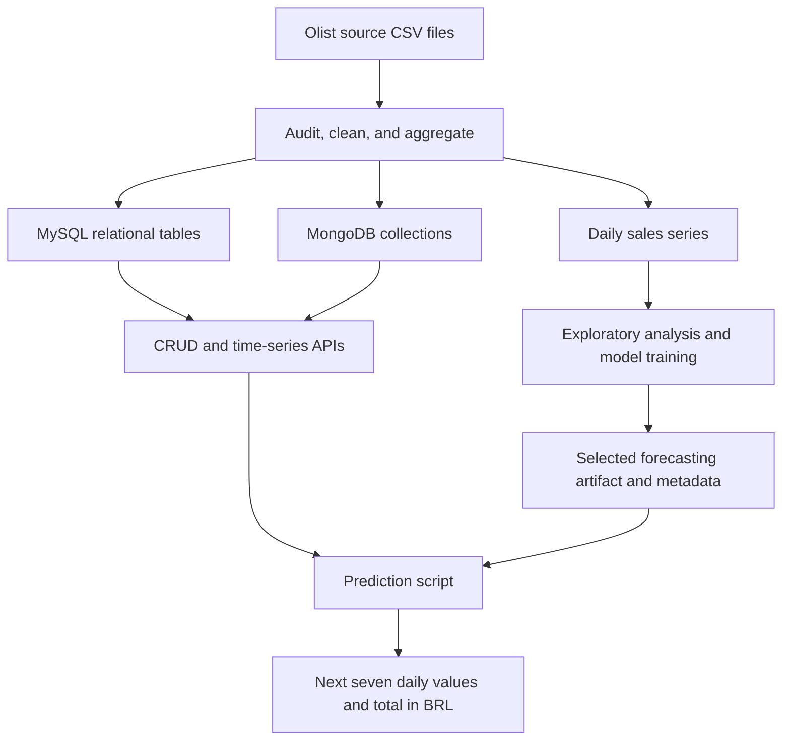

# Working with Time Series Data

## Olist Sales Forecasting and Data Pipeline

This group project builds an end-to-end time-series workflow using the **Brazilian E-Commerce Public Dataset by Olist**. We connect exploratory analysis and forecasting with relational and document databases, API access, and a prediction script that consumes historical data through those APIs.

Our central business question is:

> Can historical purchasing activity help us predict the total value of products customers will order over the next seven days?

The project brings together four parts: preparing and understanding the data, storing it in MySQL and MongoDB, exposing CRUD and time-series endpoints, and generating forecasts from API-supplied records.

## Project status

The repository currently contains the source CSV files, the Task 1 analysis and modeling notebook, Task 2 database scripts, Task 3 API endpoints, dependency information, and a methodology review. The integrated prediction script is still to be added.

| Component | Current status | Expected outputs |
| --- | --- | --- |
| Task 1 — Preprocessing, analysis, and modeling | Notebook available; complete clean-session execution still needs verification | Visualizations, interpretations, experiment comparisons, evaluation tables, and model metadata |
| Task 2 — MySQL and MongoDB | Planned | ERD, SQL scripts, collection design, sample documents, and query results |
| Task 3 — CRUD and time-series APIs | FastAPI app in `api/`; CRUD for customers, products, orders, and items on MySQL and MongoDB | POST, GET, PUT, and DELETE for both databases, plus latest-record and date-range queries |
| Task 4 — Integrated forecasting | `predict.py` fetches API data, rebuilds the Task 1 features, loads the selected model, and forecasts the next 7 days | Forecast table (7 daily values and total in BRL) |
| Final report | Planned | PDF explaining all four tasks, results, and actual team contributions |

## Dataset and prediction target

We use the [Brazilian E-Commerce Public Dataset by Olist on Kaggle](https://www.kaggle.com/datasets/olistbr/brazilian-ecommerce). It contains purchase timestamps, item prices, order statuses, customer and seller information, payments, reviews, and product attributes. These records support both time-series modeling and database design across related entities.

| Source table | Role in the project |
| --- | --- |
| Orders | Purchase timestamps, order statuses, and customer relationships |
| Order items | Item prices, quantities derived from item rows, freight, and product/seller relationships |
| Customers | Customer identifiers and location attributes |
| Sellers | Seller identifiers and location attributes |
| Products | Product categories and physical attributes |
| Category translations | English translations of product category names |
| Payments | Payment methods, installments, and payment values |
| Reviews | Review scores, comments, and review timestamps |
| Geolocation | Postal-prefix coordinates and location information |

The current forecasting notebook uses **orders and order items**. The other tables are available for database work and further analysis.

### What we forecast

- **Time axis:** order purchase date, aggregated to daily intervals.
- **Target:** daily merchandise value, calculated as the sum of item `price` in Brazilian reais (BRL).
- **Horizon:** seven individual daily forecasts, summed to obtain the next seven days' total.
- **Current analysis window:** 1 January 2017–31 August 2018, selected after examining temporal coverage.
- **Scope:** freight is excluded. All order statuses with usable item values are included; the target represents recorded merchandise value, rather than profit or net realized revenue.

Orders without usable item values are reported instead of receiving fabricated prices. A day with zero recorded sales does not establish that customer demand was truly zero.

## How the pipeline fits together

The intended workflow is:



All components should preserve the same target definition, date handling, aggregation rules, feature order, and forecast horizon. This keeps forecasts consistent with the data used during training.

## Task 1 — Time-series preprocessing and exploratory analysis

The [analysis notebook](notebooks/1-sales-forecasting-preprocessing-analysis.ipynb) covers dataset understanding, six analytical questions, and a forecasting experiment.

### Data preparation

The notebook examines temporal coverage, missing values, duplicate records, key consistency, numerical distributions, and unusually large observations. It aggregates item values per order before joining to orders, preventing one-to-many joins from inflating order counts.

The preprocessing approach:

- Removes exact duplicate rows and checks for conflicting keys and orphan items.
- Parses timestamps and checks item prices for missing, non-finite, or negative values.
- Excludes an entire order from the monetary target when its item prices are invalid.
- Retains missing delivery or approval timestamps because they are not required to define purchase-day sales.
- Builds a regular daily calendar and reports dates without known item-bearing orders.
- Retains large sales observations for investigation instead of automatically clipping the target.

### Analytical questions

Each question includes a visualization and a numerical interpretation generated from the loaded data.

| Question | Analysis |
| --- | --- |
| Does daily merchandise value show a rising or falling pattern? | Daily sales and a trailing 28-day mean |
| Does merchandise value vary by day of the week? | Weekday distributions and average sales |
| Are sales related to sales 1, 7, 14, or 28 days earlier? | Lag correlations and a weekly-lag scatter plot |
| How informative are the previous 7-day and 28-day moving averages? | Historical moving-average correlations and scatter plots |
| How does sales value relate to order volume and average order value? | Scatter plots and descriptive correlations |
| Which days have unusually high sales relative to recent history? | A historical mean-and-standard-deviation threshold |

The lag and moving-average questions address the assignment's requirement for historical feature analysis. Descriptive relationships are interpreted as associations, without claiming causality.

### Modeling and evaluation

The notebook compares a **seasonal-naive baseline**, which repeats the previous week's sales, with a **tuned multi-output random forest** that predicts seven days directly.

Features include historical sales, trailing sales statistics, historical order counts, and calendar information available at the forecast origin. Random-forest depth and minimum leaf size are tuned using expanding time-series cross-validation.

The experiment uses chronological training data, a 28-day validation period, and a final 28-day test period. Seven-row gaps prevent training target windows from overlapping later evaluation origins. Validation daily MAE selects the approach before the held-out test is evaluated.

Evaluation reports daily MAE, daily RMSE, seven-day-total MAE, and error by forecast horizon. The experiment table compares the baseline and tuned forest; actual scores should be taken from a complete notebook run.

## Task 2 — Design and implement MySQL and MongoDB databases

This stage will store the selected dataset in both database systems and explain how each design supports the project queries.

### MySQL

The relational implementation must include at least three related tables, an entity-relationship diagram, and executable SQL schema scripts. Orders, order items, and products provide a natural starting point; customer and seller tables can extend the design.

The implementation will document primary and foreign keys, data types, timestamp handling, and indexes for the queries it supports. At least three queries must be demonstrated with their results, such as daily merchandise totals, purchases within a date range, and product-category sales summaries.

### MongoDB

The document implementation will define collections, provide sample documents, and explain embedding or referencing decisions. An order document containing purchase information and embedded item details is one candidate design to evaluate.

At least three queries must be shown with their results. Useful examples include retrieving the latest order, filtering purchases by date range, and aggregating daily merchandise value. Aggregations should follow the same target rules as the notebook and MySQL implementation.

## Task 3 — Create CRUD and time-series endpoints

The API layer will support **both MySQL and MongoDB**. Each database must expose the following operations:

| Operation | HTTP method | Purpose |
| --- | --- | --- |
| Create | POST | Add a record |
| Read | GET | Retrieve records or a specific record |
| Update | PUT | Modify an existing record |
| Delete | DELETE | Remove a record |
| Latest record | GET | Retrieve the most recent record by the documented timestamp field |
| Date-range query | GET | Retrieve records between specified dates |

Full route tables, status codes, curl sequences, and troubleshooting are in [`api/README.md`](api/README.md). The FastAPI app (`api/main.py`) mirrors every operation on `/mysql` and `/mongo` for the four Task 2 stores: customers, products, orders, and order items.

| Operation | Example (MySQL; swap `/mysql` for `/mongo`) |
| --- | --- |
| Create | `POST /mysql/customers`, `POST /mysql/products`, `POST /mysql/orders`, `POST /mysql/order-items` |
| Read list / one | `GET /mysql/orders`, `GET /mysql/orders/{order_id}` (same pattern for the other resources) |
| Update | `PUT /mysql/orders/{order_id}` |
| Delete | `DELETE /mysql/orders/{order_id}` (also deletes that order's items) |
| Latest record | `GET /mysql/orders/latest` |
| Date range | `GET /mysql/orders/range?start_date=&end_date=` |

Daily merchandise totals use the same exclusion rules as Task 2 Query 3: `GET /mysql/sales/daily` and `GET /mysql/sales/daily/latest`.

Start Docker Desktop, then:

```bash
docker compose up -d
uvicorn api.main:app --reload --port 8000
curl -s http://127.0.0.1:8000/health
curl -s -X POST http://127.0.0.1:8000/demo/seed
bash api/test_crud.sh
```

`POST /demo/seed` inserts `demo-customer-001`, `demo-product-001`, and `demo-order-001` into both databases so MySQL foreign keys are satisfied during testing.

## Task 4 — Create the prediction and forecast script

`predict.py` connects the earlier tasks. It forecasts the next seven days of merchandise value (sum of item `price`, BRL).

1. **Fetch:** calls `GET /{mysql|mongo}/sales/daily/latest` and `GET /{mysql|mongo}/sales/daily` for about 35 days of history.
2. **Preprocess:** builds a regular daily calendar (days with no recorded sales become 0, as in Task 1) and the notebook's features: lags 0, 1, 6, 7, 13, 27; 7- and 28-day rolling mean and standard deviation of sales; 7- and 28-day mean order counts; weekday, next-day weekday and month, and a time index.
3. **Load model:** reads `models/metadata.json`. If the tuned random forest was selected it loads `models/selected_random_forest.joblib`; if the seasonal-naive baseline won, it repeats the last seven observed days.
4. **Forecast:** prints the seven daily values and their total.

### Setup

Copy `selected_random_forest.joblib` and `metadata.json` from the notebook output (`olist_task1_outputs/`) into `models/`. Start the databases and API (see `api/README.md`) and load the Olist data into them.

### Run

```bash
python predict.py                      # MySQL endpoints, latest day (capped at the end of the training window)
python predict.py --db mongo           # MongoDB endpoints
python predict.py --origin 2018-08-20  # forecast the 7 days after a chosen date
python predict.py --baseline           # seasonal-naive baseline
```

Set `API_BASE` (default `http://127.0.0.1:8000`) or `MODEL_DIR` (default `models/`) to point elsewhere.

### Behaviour and limits

- The forecast origin is the last observed day. Without `--origin`, the script uses the API's latest day but not past the end of the Task 1 analysis window (31 Aug 2018), because later days are sparsely recorded.
- It stops with a clear message if the API is unreachable, the history is mostly missing (under 75% of the last 28 days), or the model file is absent.
- The API's daily totals exclude `canceled` and `unavailable` orders, so training data and API data should use the same status rule.

## Repository structure

```text
.
├── data/                    # Nine supplied Olist CSV files
├── notebooks/
│   └── 1-sales-forecasting-preprocessing-analysis.ipynb
├── docs/
│   └── notebook-analysis.md # Methodology review and limitations
├── Database/                # MySQL schema, queries, MongoDB design, ERD
├── api/                     # FastAPI CRUD and time-series endpoints
├── models/                  # Selected model and metadata.json from the notebook
├── predict.py               # Task 4 forecast script
├── .gitignore
├── requirements.txt
└── README.md
```

The final report will be added when it is complete.

## Run the available analysis

### Kaggle

1. Create a Kaggle notebook and attach the Olist dataset using **Add Input**.
2. Upload the project notebook and run its cells in order.
3. Download `olist_task1_outputs.zip` from the notebook outputs.

### Google Colab

1. Upload the notebook to Colab.
2. Run the cells in order and upload `olist_orders_dataset.csv` and `olist_order_items_dataset.csv` when prompted.
3. Use the final cell to download the output ZIP.

### Local environment

Install the current analysis dependencies:

```bash
python -m venv .venv
source .venv/bin/activate
python -m pip install -r requirements.txt
```

Open the notebook in a notebook-capable editor using this environment. Before execution, adapt `ROOT` to the local `data/` directory, set `OUT` to a writable output directory, and update the archive destination in the final cell. The notebook currently assumes Kaggle or Colab paths and does not automatically discover this repository's local CSV files.

`requirements.txt` covers the notebook and the Task 3 API (`fastapi`, `uvicorn`, `pymysql`, `pymongo`).

### Generated artifacts

The notebook exports:

- `daily_merchandise_sales.csv` — daily sales, order counts, item counts, and average order value.
- `training_cv_results.csv` — random-forest tuning comparisons.
- `validation_experiments.csv` — baseline and tuned-model validation metrics.
- `test_weekly_totals.csv` and `test_daily_predictions.csv` — held-out forecasts and actual values.
- `metadata.json` — target definition, feature list, selected approach, evaluation metrics, and runtime version information.
- `selected_random_forest.joblib` — model artifact, only when the forest is selected.

Use a clean output directory for each full run so that artifacts from an earlier experiment are not included in a later export. Load joblib artifacts only from trusted sources.

## Final submission

The submission will include a GitHub repository link and a PDF report describing:

- Dataset choice, preprocessing decisions, analytical questions, visualizations, and interpretations.
- Model selection, hyperparameter tuning, experiment comparisons, and evaluation results.
- MySQL ERD and schema, MongoDB collection design, sample documents, and at least three queries with results for each database.
- CRUD operations for both databases, latest-record queries, and date-range queries with request and response evidence.
- The integrated API-to-forecast workflow and an example prediction.
- Each team member's actual contributions and the major components they completed.

Team attribution should reflect completed work and be recorded by the group in the final report.

## Limitations and reproducibility

The dataset has sparse observations at its temporal edges and less than two complete years in the selected analysis window. Missing item values, collection coverage, and sales spikes can influence both the series and its forecasts. Four validation weeks and four test weeks provide a limited basis for comparing approaches.

The supplied notebook is partially executed. Its Python syntax and notebook format have been validated, but a full clean-session training run remains necessary before reporting final performance. See the [notebook analysis](docs/notebook-analysis.md) for the detailed review.

## Data attribution

The source dataset is provided by Olist through Kaggle. Consult the dataset's source page for applicable licensing and attribution requirements before redistributing or publishing the data.
